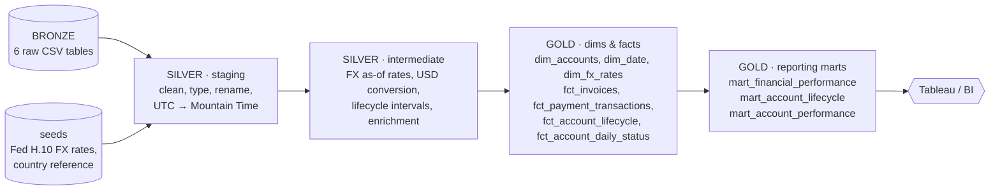
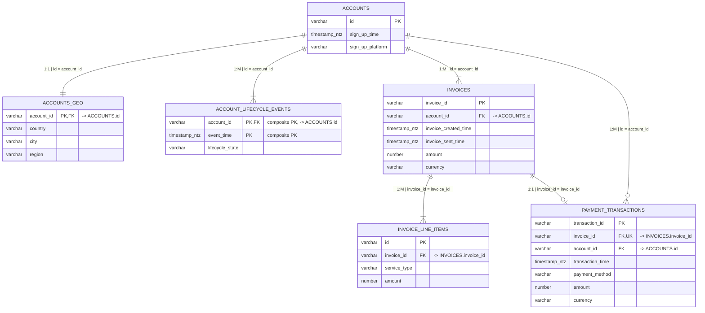

# Kaggle Data Modelling Project – Snowflake + dbt Core

A Bronze → Silver → Gold warehouse built on six CSV extracts from a Kaggle dataset of a field-service SaaS business. It delivers three BI-ready business metrics:

| Metric | Definition | Model |
|---|---|---|
| **Gross Payment Volume (GPV)** | `SUM(amount_usd)` of payment transactions, converted at historical FX rates | `fct_payment_transactions` |
| **Invoice Volume** | `COUNT(DISTINCT invoice_id)`, plus Invoice Dollar Volume in USD | `fct_invoices` |
| **Accounts by lifecycle stage** | Point-in-time counts of Trial, Subscribed and Churned accounts on any date | `fct_account_daily_status` |

- **Segmentation:** every metric can be split by **country, region, city and sign-up platform**.
- **Standardisation:** all dates are in **Mountain Time** (`America/Denver`) and all money is in **USD**.

**Stack:** Snowflake · dbt Core 1.12 · dbt_utils · 22 models · 2 seeds · 176 tests

---

## Architecture



| Layer | Schema | Materialisation | Purpose |
|---|---|---|---|
| Bronze | `BRONZE` | Tables (loaded by SQL script) | Raw CSVs, untouched by dbt |
| Silver | `SILVER` | Views | Standardisation, timezone and currency conversion, reusable logic |
| Gold | `GOLD` | Tables | Star schema and reporting marts for BI |

## Documentation

| Document | Contents |
|---|---|
| [docs/architecture.md](docs/architecture.md) | Layers, full DAG, star schema, **why / grain / logic for every model**, fanout controls |
| [docs/methodology.md](docs/methodology.md) | Currency conversion, timezone conversion, historical lifecycle tracking |
| [docs/metrics.md](docs/metrics.md) | Metric definitions, rate calculations, mart grains, additivity rules |
| [docs/data_quality.md](docs/data_quality.md) | Testing approach, data quality findings, business assumptions, limitations |
| [docs/data_dictionary.md](docs/data_dictionary.md) | Every column of every model, with types (generated from dbt) |
| [docs/bi_connection.md](docs/bi_connection.md) | Connecting Tableau, which table to use, calculations |
| [docs/phase_1_2_discovery_and_design.md](docs/phase_1_2_discovery_and_design.md) | Original discovery findings and the approved design proposal |

Interactive DAG and model docs: `dbt docs generate && dbt docs serve`.

## Quick start

Prerequisites: Bronze loaded ([Snowflake Setup](#snowflake-setup)) and dbt configured ([dbt Setup](#dbt-setup)).

```bash
source .venv/bin/activate
dbt deps                       # install dbt_utils
dbt build                      # seeds + models + tests → DEV_SILVER / DEV_GOLD
dbt build --target prod        # same, into SILVER / GOLD
dbt docs generate --target prod && dbt docs serve
python scripts/generate_data_dictionary.py   # refresh docs/data_dictionary.md
```

A successful build reports `PASS=198 WARN=2 ERROR=0`. The two warnings are intentional data-quality reports: 61 stale trials and 27 post-churn records (see [data_quality.md](docs/data_quality.md)).

**Useful selectors:**
- `dbt build --select tag:reporting` builds the marts only.
- `dbt build --select +mart_account_lifecycle` builds a mart plus everything upstream of it.
- `dbt test --select test_type:singular` runs the reconciliation tests.

## Repository structure

```
.
├── static_csv_files/                  # Source CSVs
├── snowflake/01_setup_bronze.sql      # Warehouse, database, schemas, stage + Bronze load
├── dbt_project.yml                    # Schema routing, materialisations, tags, project variables
├── packages.yml / package-lock.yml    # dbt_utils
├── requirements.txt                   # Pinned dbt-core + dbt-snowflake
├── seeds/
│   ├── fx_rates_fred_h10.csv          # Federal Reserve H.10 daily FX rates (public domain)
│   └── country_reference.csv          # Country → ISO code → local currency
├── macros/
│   ├── generate_schema_name.sql       # dev → DEV_SILVER/DEV_GOLD, prod → SILVER/GOLD
│   └── to_mountain_time.sql           # The single timezone conversion rule
├── models/
│   ├── silver/
│   │   ├── staging/                   # _sources.yml, _staging.yml, 7 stg_* models
│   │   └── intermediate/              # 5 int_* models
│   └── gold/
│       ├── dimensions/                # dim_accounts, dim_date, dim_fx_rates
│       ├── facts/                     # fct_invoices, fct_payment_transactions,
│       │                              # fct_account_lifecycle, fct_account_daily_status
│       └── reporting/                 # 3 mart_* models
├── tests/                             # 14 singular tests: financial/, lifecycle/, reporting/, data_quality/
├── analyses/source_profiling.sql      # Phase 1 profiling queries
├── scripts/generate_data_dictionary.py
└── docs/                              # See Documentation above
```

## Key design decisions

| Decision | Choice | Rationale |
|---|---|---|
| Source timezone | Assumed **UTC**, converted to `America/Denver` via one macro | NTZ timestamps carry no zone and the data shows no local-time pattern; DST handled by IANA rules; configurable |
| FX source | **Federal Reserve H.10** (FRED) as a seed; as-of rate on or before each date | Direct USD pairs, public domain, reproducible; no future or fabricated rates |
| Lifecycle history | **Effective-dated intervals** + a **daily account snapshot** | Exact history; point-in-time counts become simple filters; no double counting |
| Marts | Aggregate each fact separately, then join on a key union | No fanout; every mart reconciles to source in tests |
| Data quality | **Flag, never drop** (`is_post_churn_activity`, `is_stale_trial`, `is_paid`) | Totals always reconcile; anomalies stay visible |

---

## Snowflake Setup

### 1. Create a free Snowflake trial account
1. Sign up at [signup.snowflake.com](https://signup.snowflake.com/). The trial lasts 30 days and includes about $400 of credits, with no credit card required.
2. Choose the **Enterprise** edition and any cloud provider/region near you (AWS or Azure are fine).
3. Confirm your email, then create a username and password. New accounts must enrol in **MFA** (typically the Duo Mobile app).
4. You'll land in **Snowsight**, Snowflake's web interface.

### 2. Create the Snowflake objects (Part A)
In Snowsight, go to **Projects → Workspaces** (or **Worksheets**) and create a new SQL file. Paste in **Part A** of [`snowflake/01_setup_bronze.sql`](snowflake/01_setup_bronze.sql) and click **Run All**.

Part A creates:
- **Warehouse** `COMPUTE_WH`: XSMALL, auto-suspends after 60 idle seconds to conserve credits.
- **Database** `KAGGLE_DB`, with schemas `BRONZE`, `SILVER` and `GOLD`.
- **File format** `BRONZE.CSV_FORMAT` and internal **stage** `BRONZE.RAW_CSV_STAGE` (the storage area the CSVs are uploaded into before loading).

All objects are created with the `SYSADMIN` role rather than `ACCOUNTADMIN`.

### 3. Upload the CSVs to the stage
1. In Snowsight, go to **Catalog / Data → Databases → KAGGLE_DB → BRONZE → Stages → RAW_CSV_STAGE**.
2. Click **+ Files** and upload all 6 files from [`static_csv_files/`](static_csv_files/).
3. Run `LIST @RAW_CSV_STAGE;` and confirm all 6 files are listed.

### 4. Load the bronze tables (Part B)
Run **Part B** of the script. It creates the 6 bronze tables, loads each one with `COPY INTO`, and finishes with a row-count check. Expected counts:

| Table | Rows |
|---|---|
| `ACCOUNTS` | 200 |
| `ACCOUNTS_GEO` | 200 |
| `ACCOUNT_LIFECYCLE_EVENTS` | 427 |
| `INVOICES` | 609 |
| `INVOICE_LINE_ITEMS` | 1848 |
| `PAYMENT_TRANSACTIONS` | 435 |

Bronze design notes:
- **Columns match the source CSVs.** Renaming and cleanup belong in silver.
- **Audit columns.** Every table has `_SOURCE_FILE` (the staged file the row came from) and `_LOADED_AT` (load timestamp).
- **Amounts are stored as whole numbers** (e.g. `7632`), as in the source. Whether these are dollars or cents is decided in silver.
- **Re-runnable.** Tables use `CREATE OR REPLACE`, so re-running Part B is a full reload with no duplicate rows.

### 5. Connect VS Code to Snowflake
1. In VS Code, open the Extensions panel (`⇧⌘X`), search for **Snowflake**, and install the official extension published by Snowflake.
2. Click the Snowflake icon in the sidebar and sign in with:
   - **Account identifier**: in Snowsight, click your name (bottom-left) → **Account → View account details**. Format: `ORGNAME-ACCOUNTNAME`.
   - **Username and password**, then approve the Duo MFA push.
3. Open any `.sql` file and press `⌘+Enter` to run the statement under the cursor. Use the sidebar's object browser to explore `KAGGLE_DB.BRONZE`.
4. *Optional:* to avoid an MFA prompt on every connection, set up [key-pair authentication](https://docs.snowflake.com/en/user-guide/key-pair-auth). The same key can be reused by dbt later.

---

## Bronze Layer ERD



Every bronze table also carries the `_SOURCE_FILE` and `_LOADED_AT` audit columns, which are omitted from the diagram.

### Legend

Each line is labelled `<cardinality> | <parent column> = <child column>`. The parent is the table on the "one" side of the relationship.

| Label | Meaning | Used in this layer |
|---|---|---|
| **1:1** | One-to-one: each parent row matches at most one child row | `ACCOUNTS` → `ACCOUNTS_GEO`, `INVOICES` → `PAYMENT_TRANSACTIONS` |
| **1:M** | One-to-many: each parent row can match many child rows | All other relationships |
| **M:M** | Many-to-many: rows on both sides can match many rows on the other | None |

Line-end symbols (crow's foot notation):

| Symbol | Meaning |
|---|---|
| `\|\|` (two bars) | Exactly one |
| `o\|` (circle + bar) | Zero or one (optional) |
| `\|{` (bar + crow's foot) | One or many |
| `o{` (circle + crow's foot) | Zero or many (optional) |

For example, the line `INVOICES ||--o| PAYMENT_TRANSACTIONS` reads: every payment belongs to exactly one invoice, and an invoice has zero or one payment.

### Keys

| Table | Primary key | Foreign keys |
|---|---|---|
| `ACCOUNTS` | `id` | — |
| `ACCOUNTS_GEO` | `account_id` | `account_id` → `ACCOUNTS.id` |
| `ACCOUNT_LIFECYCLE_EVENTS` | (`account_id`, `event_time`) | `account_id` → `ACCOUNTS.id` |
| `INVOICES` | `invoice_id` | `account_id` → `ACCOUNTS.id` |
| `INVOICE_LINE_ITEMS` | `id` | `invoice_id` → `INVOICES.invoice_id` |
| `PAYMENT_TRANSACTIONS` | `transaction_id` | `invoice_id` → `INVOICES.invoice_id` (also unique)<br>`account_id` → `ACCOUNTS.id` |

### Relationships

| Join | Cardinality | Observed in data |
|---|---|---|
| `ACCOUNTS.id` = `ACCOUNTS_GEO.account_id` | 1:1 (mandatory both sides) | Every account has exactly 1 geo row |
| `ACCOUNTS.id` = `ACCOUNT_LIFECYCLE_EVENTS.account_id` | 1:M (1..n) | 1–3 events per account; each state appears at most once per account |
| `ACCOUNTS.id` = `INVOICES.account_id` | 1:M (1..n) | 1–5 invoices per account; every account has at least one |
| `ACCOUNTS.id` = `PAYMENT_TRANSACTIONS.account_id` | 1:M (0..n) | 16 accounts have no payments |
| `INVOICES.invoice_id` = `INVOICE_LINE_ITEMS.invoice_id` | 1:M (1..n) | 1–5 line items per invoice; line items sum exactly to the invoice amount |
| `INVOICES.invoice_id` = `PAYMENT_TRANSACTIONS.invoice_id` | 1:1 (0..1 on the payment side) | 435 invoices paid with a single full payment; 174 unpaid |

There are no many-to-many relationships.

### Notes
- **Keys are logical, not enforced.** Snowflake doesn't enforce primary or foreign key constraints on standard tables. The keys above were validated by profiling and are enforced by dbt tests (`unique`, `not_null`, `relationships`) on the sources and every downstream layer.
- **Payments store `account_id` redundantly.** `PAYMENT_TRANSACTIONS.account_id` can also be derived through `INVOICES`. The two always agree; `assert_payment_account_matches_invoice_account` tests this on every build.
- **Lifecycle events have no surrogate key.** The natural key (`account_id`, `event_time`) is unique; silver derives `lifecycle_event_id = hash(account_id, event_time)`.
- **Account ID naming is inconsistent.** It's `id` in `ACCOUNTS` but `account_id` everywhere else; silver standardises it to `account_id`.

---

## dbt Setup

### 1. Install dbt-core
From the repo root, create a virtual environment and install the pinned versions:
```bash
python3 -m venv .venv
source .venv/bin/activate
pip install -r requirements.txt
dbt deps
dbt --version
```

### 2. Set up key-pair authentication
dbt opens many connections per run, so password + MFA would prompt on every one. Use a key pair instead.

1. Generate a key pair **outside the repo**:
   ```bash
   mkdir -p ~/.snowflake/keys && cd ~/.snowflake/keys
   openssl genrsa 2048 | openssl pkcs8 -topk8 -inform PEM -out rsa_key.p8 -nocrypt
   openssl rsa -in rsa_key.p8 -pubout -out rsa_key.pub
   chmod 600 rsa_key.p8
   ```
2. Register the public key on your Snowflake user (paste the contents of `rsa_key.pub` without the `-----BEGIN/END PUBLIC KEY-----` lines):
   ```sql
   USE ROLE ACCOUNTADMIN;
   ALTER USER <your_username> SET RSA_PUBLIC_KEY = '<public key>';
   ```

### 3. Configure the dbt profile
Create `~/.dbt/profiles.yml`. It lives outside the repo, so credentials are never committed. It needs two targets:
```yaml
kaggle_dwh:
  target: dev
  outputs:
    dev:                               # dbt build                → DEV_SILVER / DEV_GOLD
      type: snowflake
      account: <ORGNAME-ACCOUNTNAME>
      user: <your_username>
      private_key_path: /Users/<you>/.snowflake/keys/rsa_key.p8
      role: SYSADMIN
      warehouse: COMPUTE_WH
      database: KAGGLE_DB
      schema: DEV
      threads: 4
    prod:                              # dbt build --target prod  → SILVER / GOLD
      type: snowflake
      account: <ORGNAME-ACCOUNTNAME>
      user: <your_username>
      private_key_path: /Users/<you>/.snowflake/keys/rsa_key.p8
      role: SYSADMIN
      warehouse: COMPUTE_WH
      database: KAGGLE_DB
      schema: PROD
      threads: 4
```
`macros/generate_schema_name.sql` routes models: the `prod` target writes to exactly `SILVER` / `GOLD`, and any other target writes to `DEV_SILVER` / `DEV_GOLD`.

### 4. Verify the connection
```bash
dbt debug
```
You should see `All checks passed!`.

### Project variables
Business rules live in `dbt_project.yml` under `vars`, so changing an assumption is a one-line change:

| Variable | Value | Meaning |
|---|---|---|
| `source_timezone` | `UTC` | Assumed zone of source timestamps |
| `reporting_timezone` | `America/Denver` | Reporting zone |
| `reporting_start_date` / `reporting_end_date` | `2024-01-01` / `2025-08-12` | Date spine and as-of date |
| `stale_trial_days` | `90` | Threshold for `is_stale_trial` |
| `trial_conversion_window_days` | `90` | Window for `has_converted_within_window` |
| `max_fx_staleness_days` | `4` | Longest allowed FX carry-forward |
