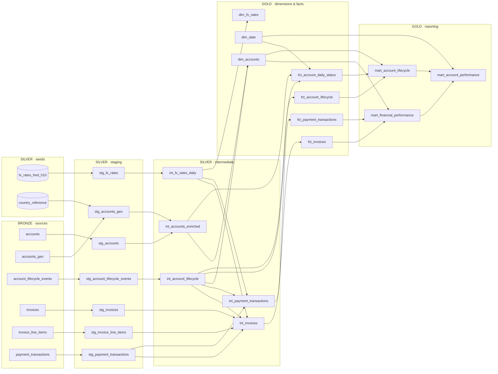
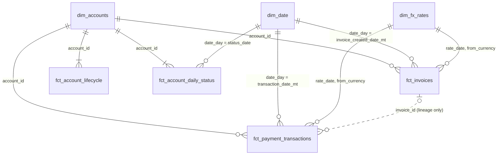

# Architecture

This warehouse turns six raw Jobber CSV extracts into BI-ready models for **Gross Payment Volume**, **Invoice Volume** and **account lifecycle counts**. Every metric can be segmented by country, region, city and sign-up platform, and trended over time.

- **Stack:** Snowflake + dbt Core 1.12, with `dbt_utils` as the only package.
- **Size:** 22 models, 2 seeds, 176 tests.

---

## 1. Medallion layers

| Layer | Snowflake schema | Materialisation | Contents | Rule |
|---|---|---|---|---|
| **Bronze** | `KAGGLE_DB.BRONZE` | Tables (loaded by `snowflake/01_setup_bronze.sql`) | 6 raw CSVs + `_SOURCE_FILE` / `_LOADED_AT` audit columns | Never modified by dbt. Read only through `source()`. |
| **Silver** | `KAGGLE_DB.SILVER` | Views (+ 2 seed tables) | Staging (1:1 with source), intermediate (reusable logic), FX reference data | No metrics. Standardise, convert, enrich. |
| **Gold** | `KAGGLE_DB.GOLD` | Tables | Dimensions, facts, reporting marts | The only layer BI tools connect to. |

**Environments.** `macros/generate_schema_name.sql` routes models by target:

| Target | Command | Schemas |
|---|---|---|
| `dev` (default) | `dbt build` | `DEV_SILVER`, `DEV_GOLD` |
| `prod` | `dbt build --target prod` | `SILVER`, `GOLD` (exact names) |

This replaces dbt's default `<target>_<custom>` naming, so development runs can never overwrite production tables.

---

## 2. DAG

The interactive version is in the dbt docs (`dbt docs generate && dbt docs serve`).

---

## 3. Gold star schema

- **Segmentation:** every fact joins to `dim_accounts` for country, region, city and platform.
- **Facts are never joined to each other for metrics.** The dotted invoice → payment line is for drill-through lineage only, and each metric comes from exactly one fact.

---

## 4. Model catalogue

Each significant model below is described by: **why** it exists · **grain** · **upstream** inputs · **logic** · **data quality** · what it **supports** in reporting.

### 4.1 Silver – staging

**`stg_accounts`, `stg_accounts_geo`, `stg_account_lifecycle_events`, `stg_invoices`, `stg_invoice_line_items`, `stg_payment_transactions`**

- **Why:** one cleaned, typed and consistently named version of each source, so no downstream model touches raw columns.
- **Grain:** identical to the source table (1:1).
- **Upstream:** `source('bronze', …)`. `stg_accounts_geo` also uses the `country_reference` seed.
- **Logic:**
  - **Renames:** lowercase snake_case, e.g. `id` → `account_id` / `invoice_line_item_id`.
  - **Casts:** amounts to `NUMBER(18,2)`.
  - **Text clean-up:** `TRIM`, lowercased categoricals, uppercased currency codes.
  - **Timestamps:** every one is kept as `*_at_utc` (the original) and converted to `*_at_mt` / `*_date_mt` via the `to_mountain_time` macro.
  - **Lifecycle key:** lifecycle events get a surrogate key, `hash(account_id, event_time)`.
  - **Geography:** gets an ISO `country_code` and the expected local currency.
- **Data quality:**
  - `unique` + `not_null` on every key.
  - `relationships` for every foreign key.
  - `accepted_values` for platform, state, country, currency and payment method.
  - Amounts must be greater than 0.
- **Supports:** everything downstream. Timezone conversion lives here because it's standardisation, not business logic, so every model gets identical Mountain Time values.

**`stg_fx_rates`**

- **Why:** FRED series use different quote directions, so they're normalised to a single convention.
- **Grain:** one row per published rate date per currency.
- **Upstream:** `fx_rates_fred_h10` seed.
- **Logic:** converts to *1 unit of currency = X USD*. `DEXCAUS` (CAD per USD) is inverted; `DEXUSUK` and `DEXUSAL` are used as published. USD identity rows (1.0) are added.
- **Data quality:** (`rate_date`, `from_currency`) is unique; rate is greater than 0; currency is in the accepted list.
- **Supports:** all USD conversion.

### 4.2 Silver – intermediate

**`int_fx_rates_daily`**

- **Why:** the single home of the weekend/holiday FX rule. Invoices and payments then convert with a plain equi-join, and the as-of logic can be tested once.
- **Grain:** one row per calendar date per currency (590 days × 4 currencies = 2,360 rows).
- **Upstream:** `stg_fx_rates`, plus a `dbt_utils.date_spine`.
- **Logic:** `ASOF JOIN … MATCH_CONDITION (calendar_date >= rate_date)` takes the latest rate published **on or before** each date. A future rate is never applied.
- **Data quality:** one row per date and currency; no gaps (`assert_fx_rates_complete`); `days_since_published <= 4`.
- **Supports:** `int_invoices`, `int_payment_transactions`, `dim_fx_rates`.

**`int_accounts_enriched`**

- **Why:** one row per account carrying every segmentation attribute.
- **Grain:** one row per account.
- **Upstream:** `stg_accounts`, `stg_accounts_geo`.
- **Logic:** a `LEFT JOIN`, so accounts without geography are kept and labelled `'Unknown'` rather than dropped. `has_geography` flags them.
- **Data quality:** `account_id` is unique, which proves geography didn't duplicate any accounts. `assert_segmentation_complete` fails if any `'Unknown'` appears.
- **Supports:** `dim_accounts`, `fct_account_daily_status`.

**`int_account_lifecycle`**

- **Why:** turns the raw event log into sequenced, effective-dated history. This is the backbone of every lifecycle metric.
- **Grain:** one row per account lifecycle event (427).
- **Upstream:** `stg_account_lifecycle_events`.
- **Logic:**
  - **Sequencing:** `ROW_NUMBER()` by event time, with a tie-break by state rank (trial < subscribed < churned) in case two events ever share a timestamp. None do today.
  - **Neighbours:** `LAG`/`LEAD` give the previous and next state.
  - **Intervals:** each event opens an interval `[valid_from, valid_to)` that closes at the next event; `is_current` marks the open one.
  - **Validation:** `is_valid_transition` checks the path (start) → trial → subscribed → churned.
  - **UTC intervals:** intervals are also kept in UTC, because Mountain Time repeats an hour when daylight saving ends and so isn't strictly ordered.
- **Data quality:**
  - Intervals never overlap.
  - Each account has exactly one current state.
  - `valid_to` is NULL exactly when `is_current` is true.
  - Invalid transitions are a warn-level test.
- **Supports:** `fct_account_lifecycle`, `fct_account_daily_status`, `dim_accounts`, and the lifecycle stage at the time of each invoice and payment.

**`int_invoices`**

- **Why:** invoice-level business logic in one place.
- **Grain:** one row per invoice (609).
- **Upstream:** `stg_invoices`, `stg_invoice_line_items`, `stg_payment_transactions`, `int_fx_rates_daily`, `int_account_lifecycle`.
- **Logic:**
  - **No fanout:** line items and payments are each **aggregated to invoice grain before joining**.
  - **USD conversion:** at the invoice **created date (MT)**.
  - **Flags:** `is_amount_reconciled` (invoice amount = line-item total), `is_paid`, and the lifecycle stage when the invoice was created (an interval join in UTC).
  - **Missing rates:** the FX join is a `LEFT JOIN`, so a missing rate shows up as a NULL that the tests catch, rather than a silently dropped invoice.
- **Data quality:** unique `invoice_id`; non-null rate and USD amount; `assert_invoice_amount_matches_line_items`.
- **Supports:** `fct_invoices`.

**`int_payment_transactions`**

- **Why:** payment-level business logic in one place.
- **Grain:** one row per payment (435).
- **Upstream:** `stg_payment_transactions`, `int_fx_rates_daily`, `int_account_lifecycle`.
- **Logic:**
  - **USD conversion:** at the **transaction date (MT)**.
  - **Payment channel:** `electronic` (Credit Card, ACH, Paypal) or `offline` (Cash, Cheque).
  - **Lifecycle stage** at the time of payment.
- **Data quality:** unique `transaction_id`; non-null USD amount; channel never `unknown`; the payment's account matches its invoice's account.
- **Supports:** `fct_payment_transactions`.

### 4.3 Gold – dimensions

**`dim_accounts`**

- **Why:** the single segmentation dimension. It also holds lifecycle milestones for account-level trial-conversion analysis.
- **Grain:** one row per account, with **current** attributes as of the reporting end date (200).
- **Upstream:** `int_accounts_enriched`, `int_account_lifecycle`.
- **Logic:**
  - **Current stage:** taken from the open interval, or `pre_trial` if the account has no events yet.
  - **Milestones:** `trial_started_at_mt`, `subscribed_at_mt` and `churned_at_mt`, with the days between each.
  - **Conversion:** `has_converted_within_window` (subscribed within 90 days of trial start).
  - **Flag:** `is_stale_trial`.
- **Data quality:** unique and non-null `account_id`; no `'Unknown'` segments; current stages reconcile to the lifecycle mart on the reporting end date.
- **Supports:** segmentation in every mart, and the trial conversion rate.
- **Not here:** historical state. Current status must never stand in for history; history lives in the lifecycle facts.

**`dim_date`**

- **Why:** the date spine for point-in-time snapshots, and a standard Tableau calendar.
- **Grain:** one row per calendar date, 2024-01-01 → 2025-08-12 (590).
- **Logic:** ISO week start, month, quarter and year. `month_reporting_end_date` marks the last date with data in a partial month.
- **Supports:** `fct_account_daily_status`, `mart_account_performance`.

**`dim_fx_rates`**

- **Why:** lets anyone audit any USD amount back to the exact rate and publication date used.
- **Grain:** one row per calendar date per currency.
- **Upstream:** `int_fx_rates_daily`.

### 4.4 Gold – facts

**`fct_payment_transactions`** – the source of **GPV**

- **Grain:** one row per payment.
- **Columns:** original amount and currency, `exchange_rate`, `fx_rate_effective_date`, `fx_rate_source`, `amount_usd`, `payment_channel`, `is_post_churn_activity`.
- **No exclusions:** the source has no status, refund or failure field, so every transaction counts toward GPV.

**`fct_invoices`** – the source of **Invoice Volume** and **Invoice Dollar Volume**

- **Grain:** one row per invoice.
- **Columns:** original amount and currency, rate audit columns, `invoice_amount_usd`, line-item aggregates, `is_paid`, `is_post_churn_activity`.

**`fct_account_lifecycle`** – the source of lifecycle **flows**

- **Grain:** one row per lifecycle event, which is also one effective-dated interval.
- **Columns:** previous and next state, sequence, `valid_from_mt` / `valid_to_mt`, `is_current`, `days_in_state`.

**`fct_account_daily_status`** – the source of point-in-time lifecycle **counts**

- **Why:** it makes "how many accounts were subscribed on date D?" a simple filter. The alternative is an interval calculation in Tableau, which is easy to get wrong.
- **Grain:** one row per account per calendar date, from sign-up to the reporting end date (79,202).
- **Upstream:** `dim_date`, `int_accounts_enriched`, `int_account_lifecycle`.
- **Logic:** an `ASOF JOIN` finds the latest event before the next day starts, i.e. the **end-of-day (MT)** stage. Accounts with no event yet are `pre_trial`. The `is_*` flags are 0/1.
- **Data quality:** (`account_id`, `status_date`) is unique, and the four flags always sum to exactly 1, so no account can be counted in two stages.

### 4.5 Gold – reporting marts

All three marts share the segment keys: country, country_code, region, city and sign_up_platform.

| Mart | Grain | Built from | Shape |
|---|---|---|---|
| `mart_financial_performance` | date × segment | `fct_payment_transactions`, `fct_invoices`, `dim_accounts` | Sparse; fully additive |
| `mart_account_lifecycle` | date × segment | `fct_account_daily_status`, `fct_account_lifecycle`, `dim_accounts` | Dense; stocks are semi-additive |
| `mart_account_performance` | month × segment | Both daily marts + `dim_date` | Month-end stocks, monthly flows and financials |

- **Shared pattern:**
  1. Aggregate each source to the mart grain on its own.
  2. Build `grain_keys` as the `UNION` of all keys.
  3. `LEFT JOIN` each aggregate onto the keys.

  This keeps every row from every source, and no fact can inflate another.
- **Measure definitions** and Tableau usage are in [metrics.md](metrics.md).

---

## 5. Fanout and double-counting controls

| Risk | Control | Test |
|---|---|---|
| Line items multiply invoices | Aggregate line items to invoice grain before joining | `fct_invoices.invoice_id` unique |
| Multiple payments per invoice (not present today, but not assumed away) | Payments aggregated before joining to invoices; GPV only ever comes from the payments fact | `unique` on both facts; GPV reconciliation |
| Duplicate geography duplicates accounts | One row per account enforced | `unique` on `stg_accounts_geo` and `dim_accounts` |
| Duplicate FX rows duplicate transactions | One rate per date and currency | `unique_combination_of_columns`; source-to-fact count reconciliation |
| Overlapping lifecycle intervals | Intervals derived with `LEAD` | `assert_no_overlapping_lifecycle_intervals`, `assert_one_current_lifecycle_state_per_account` |
| An account counted in two stages on one day | One status row per account per day | Uniqueness + flags summing to 1 |
| Fact-to-fact joins in marts | Aggregate each fact independently, then key-union | GPV and invoice reconciliation to marts |
| Summing point-in-time stocks across dates | Documented as semi-additive; monthly mart exposes month-end only | `assert_monthly_mart_reconciles_to_daily` |

---

## 6. Conventions

- **SQL style:**
  - Uppercase keywords and functions; lowercase snake_case names.
  - 4-space indent and **leading commas** (`,column`, `,next_cte AS (`).
  - One column per line, and a `final` CTE.
- **Reusable macros:** every timezone conversion goes through `to_mountain_time()`; the FX as-of logic exists only in `int_fx_rates_daily`.
- **Project variables** (`dbt_project.yml`):
  - `source_timezone`, `reporting_timezone`
  - `reporting_start_date`, `reporting_end_date`
  - `stale_trial_days`, `trial_conversion_window_days`, `max_fx_staleness_days`
- **No incremental models or dbt snapshots:** with about 3k static source rows, a full rebuild takes seconds. The lifecycle source is already an append-only history, so snapshots would capture nothing.
