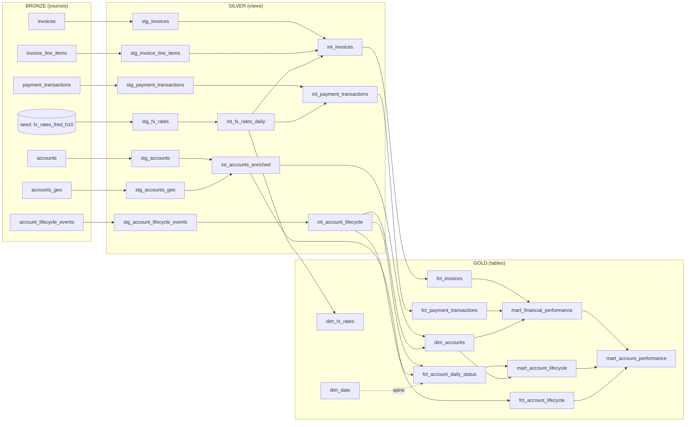

# Phase 1 & 2 – Data Discovery and Architecture Design

**Status:** Approved and implemented. This document is kept as the record of discovery findings and design decisions. For the current state of the project, see [architecture.md](architecture.md), [methodology.md](methodology.md), [metrics.md](metrics.md) and [data_quality.md](data_quality.md).
**Profiled:** 2026-11-13, against `KAGGLE_DB.BRONZE` using role `SYSADMIN`.

**Changes made during implementation:**
- **`country_reference` seed added.** The country → ISO code → currency mapping lives in a seed instead of hardcoded SQL, and it drives the currency-matches-country test.
- **Seeds load into the `SILVER` schema,** so Bronze stays untouched.
- **`mart_account_performance` simplified after review:** the cohort-conversion and opening-balance columns were removed. Trial conversion is calculated from `dim_accounts`; churn rate uses the previous month's `subscribed_accounts_eom`.
- **`amount_paid` and `is_fully_paid` removed** from `fct_invoices`; `is_paid` remains.
- **SQL uses leading commas.**

---

## Part 1 – Data Discovery

### 1.1 Environment

| Item | Finding |
|---|---|
| Repo | Clean git tree on `main`. Bronze load script in `snowflake/01_setup_bronze.sql`. |
| dbt | dbt-core 1.12.7, dbt-snowflake 1.12.5, project `kaggle_dwh`. No packages installed. |
| Schema routing | `macros/generate_schema_name.sql` already routes custom schemas to exactly `SILVER` / `GOLD`. It ignores the target, so there is no dev/prod isolation yet. |
| Sources | Declared in `models/bronze/_bronze__sources.yml`. The target structure puts them in `models/silver/staging/_sources.yml`. |
| Connection | `dbt debug` passes. Key-pair auth, role `SYSADMIN`, warehouse `COMPUTE_WH`, database `KAGGLE_DB`. |
| Session timezone | `America/Los_Angeles` (account default). This doesn't affect `CONVERT_TIMEZONE` with an explicit source zone, but it does affect how `_LOADED_AT` (TIMESTAMP_LTZ) displays and what `CURRENT_DATE()` returns. |
| Marketplace / shares | Only `SNOWFLAKE` and `SNOWFLAKE_SAMPLE_DATA` are present. No FX dataset is installed. |

### 1.2 Source schemas vs. the supplied ERD

All six tables match the supplied ERD exactly: same column names, nothing missing, nothing extra apart from our two audit columns. The types below were applied at load time by `01_setup_bronze.sql`, because the CSVs themselves are untyped text.

| Table | Rows | Columns (type) | Actual grain | ERD valid? |
|---|---|---|---|---|
| `ACCOUNTS` | 200 | `ID` text, `SIGN_UP_TIME` ntz, `SIGN_UP_PLATFORM` text | 1 row per account | ✅ |
| `ACCOUNTS_GEO` | 200 | `ACCOUNT_ID`, `COUNTRY`, `CITY`, `REGION` (text) | 1 row per account (validated unique) | ✅ |
| `ACCOUNT_LIFECYCLE_EVENTS` | 427 | `ACCOUNT_ID` text, `EVENT_TIME` ntz, `LIFECYCLE_STATE` text | 1 row per account per state change | ✅ (no surrogate key) |
| `INVOICES` | 609 | `ACCOUNT_ID`, `INVOICE_ID` text, `INVOICE_CREATED_TIME`, `INVOICE_SENT_TIME` ntz, `AMOUNT` number(38,0), `CURRENCY` text | 1 row per invoice | ✅ |
| `INVOICE_LINE_ITEMS` | 1,848 | `INVOICE_ID`, `ID`, `SERVICE_TYPE` text, `AMOUNT` number(38,0) | 1 row per line item | ✅ |
| `PAYMENT_TRANSACTIONS` | 435 | `ACCOUNT_ID`, `INVOICE_ID`, `TRANSACTION_ID` text, `TRANSACTION_TIME` ntz, `PAYMENT_METHOD` text, `AMOUNT` number(38,0), `CURRENCY` text | 1 row per payment | ✅ |

Every table also has `_SOURCE_FILE` and `_LOADED_AT`. All columns are nullable at the database level, so nulls are guarded by tests rather than constraints.

### 1.3 Integrity validation

| Check | Result |
|---|---|
| Nulls or blank strings (every column) | **0** |
| Leading/trailing whitespace | **0** |
| Exact duplicate rows | **0** |
| PK uniqueness: `accounts.id`, `invoice_id`, line item `id`, `transaction_id` | **Unique** |
| Lifecycle natural key (`account_id`, `event_time`) | **Unique**; (`account_id`, `lifecycle_state`) also unique |
| Events sharing a timestamp within an account | **0** |
| Geo rows per account | Exactly **1** for all 200 (no missing or duplicate geography) |
| FK orphans (geo, lifecycle, invoices, payments → accounts; line items, payments → invoices) | **0** |
| Payment `account_id` ≠ its invoice's `account_id` | **0** |
| Line items per invoice | 1–5 (avg 3.0) |
| Payments per invoice | 0 or 1. **No invoice has multiple payments today, but the design will not assume this.** |
| Invoice amount = Σ line items | **609 / 609 match**, 0 variance (per currency as well) |
| Payment amount = invoice amount | 435 / 435 (no partial payments or overpayments) |
| Zero or negative amounts | **0** (invoices 103–9,996; line items 1–9,846; payments 139–9,996) |
| Malformed UUIDs | **0** |
| Temporal ordering (sent ≥ created, paid ≥ sent, activity ≥ sign-up) | **0 violations** |
| Future-dated records | **0** |
| Refund / reversal / failed-payment indicators | **None exist.** There is no status column, and every amount is positive. |

### 1.4 Categorical domains

| Column | Values |
|---|---|
| `sign_up_platform` | `mobile-android` 47, `mobile-ios` 50, `mobile-ipad` 61, `web-browser` 42 |
| `lifecycle_state` | `trial` 200, `subscribed` 139, `churned` 88 |
| `service_type` | construction, install, other, maintenance, painting, cleaning, repair |
| `payment_method` | `ACH` 80, `Cash` 88, `Cheque` 87, `Credit Card` 96, `Paypal` 84 |
| `currency` (invoices & payments) | `USD`, `GBP`, `AUD`, `CAD` (already uppercase ISO-4217) |
| `country` | `United States` 60, `UK` 50, `Australia` 45, `Canada` 45 |

### 1.5 Currency findings

- **Not USD-only.** There are 4 currencies, so FX conversion is required.
- **Currency is a property of the account:** each account uses exactly one currency, with a strict 1:1 mapping (US→USD, Canada→CAD, UK→GBP, Australia→AUD). There are 0 mismatches across 609 invoices and 435 payments.
- **Dates needing a rate:**
  - Invoices: 2024-02-21 → 2025-06-10
  - Payments: 2024-02-22 → 2025-06-13

### 1.6 Timestamp / timezone findings

- **No timezone information:** all business timestamps are `TIMESTAMP_NTZ`, and the CSVs carry no offset or zone marker.
- **No local-time pattern:** the hour of day is spread almost evenly across 24 hours in every country. For example, Australian activity between 00:00 and 05:00 (141 records) is as common as 06:00–11:00 (125). If timestamps were each account's local time, activity would cluster in business hours, which it doesn't. If they were UTC, each country's peak would sit at a different UTC hour, and it doesn't either. **The data is synthetic and the source timezone can't be proven from the data.**
- **Checked against America/Denver daylight saving:** no timestamps fall in Denver's spring-forward gaps, which is uninformative given how few records exist. One timestamp (`2024-11-03 01:04:04`) falls in Denver's repeated fall-back hour. It would be ambiguous only if the source were Denver local time.
- **The choice matters for reporting:** converting from UTC to Mountain Time changes the calendar date of about 20% of records (130 of 609 invoices, 115 of 435 payments) and the month of 15. The source-timezone assumption therefore needs explicit approval.

### 1.7 Lifecycle findings

- **Only three paths exist:** `trial > subscribed > churned` (88 accounts), `trial` only (61), `trial > subscribed` (51).
- **0 invalid transitions:** nothing skips trial, goes backwards, or repeats a state.
- **Sign-up comes before trial:** the trial event always comes **1–30 days after** `sign_up_time`. Each account therefore has a period with **no lifecycle state**. That period has no invoices or payments.
- **Time in each state:**
  - Trial → subscribed: 15–89 days (median 55)
  - Subscribed → churned: 32–179 days (median 101)
- **Activity by state at the time it happened:**
  - Invoices: 343 during trial, 250 subscribed, **16 after churn**
  - Payments: 238 during trial, 186 subscribed, **11 after churn**
- **Stale trials:** the 61 trial-only accounts began their trials between 2024-01-28 and 2025-01-23. No trial ever converts after day 89, yet these accounts have no expiry event and would remain "in trial" forever.
- **Mismatched end dates:** lifecycle events extend to **2025-08-12**, but financial data ends on **2025-06-13**.

### 1.8 Geography findings

- **Region does not nest cleanly.** 18 of 20 cities are split across two regions (e.g., Calgary → `AB-North` / `AB-South`). In the UK, `England-Central` contains Birmingham and Leeds, and `England-North` contains Leeds and Manchester. Region is a territory-style attribute that cuts across cities, so **neither country → region → city nor country → city → region is a strict hierarchy**.
- Regions never span countries.
- **Inconsistent country naming:** `UK` is abbreviated, while `United States` is spelled out.

### 1.9 Data quality issues summary

| # | Issue | Severity | Proposed handling |
|---|---|---|---|
| DQ1 | 16 invoices and 11 payments dated after the account churned | Medium | Keep them in all metrics. Flag with `is_post_churn_activity`. |
| DQ2 | 61 trial-only accounts with no trial-end event | Medium | Report the state as recorded. Add `is_stale_trial` (trial older than 90 days). No inferred states. |
| DQ3 | 174 invoices unpaid; no invoice status column | Low | Count all invoices. Add `is_paid`. Document that outstanding vs. void can't be distinguished. |
| DQ4 | No transaction status (refund, failure) | Low | GPV includes all transactions. Document the limitation. |
| DQ5 | Source timezone unknown | High (affects dates) | Assume UTC (configurable). See §2.5. |
| DQ6 | Amount units unspecified (dollars vs. cents) | Medium | Assume major units (dollars). |
| DQ7 | Account has no state between sign-up and trial | Medium | Label it as a derived `pre_trial` stage. See §2.6. |
| DQ8 | Region/city not hierarchical; `UK` naming | Low | Treat as independent attributes. Add `country_code`. |
| DQ9 | Synthetic signals (fixed minutes:seconds per account, uniform lags) | Info | Document only. |

---

## Part 2 – Architecture Design

### 2.1 Medallion architecture and DAG



### 2.2 Proposed dbt project structure

```
models/
├── silver/
│   ├── staging/
│   │   ├── _sources.yml                 # moved from models/bronze/
│   │   ├── _staging.yml
│   │   ├── stg_accounts.sql
│   │   ├── stg_accounts_geo.sql
│   │   ├── stg_account_lifecycle_events.sql
│   │   ├── stg_invoices.sql
│   │   ├── stg_invoice_line_items.sql
│   │   ├── stg_payment_transactions.sql
│   │   └── stg_fx_rates.sql
│   └── intermediate/
│       ├── _intermediate.yml
│       ├── int_accounts_enriched.sql
│       ├── int_account_lifecycle.sql
│       ├── int_fx_rates_daily.sql       # NEW – the single place FX as-of logic lives
│       ├── int_invoices.sql
│       └── int_payment_transactions.sql
└── gold/
    ├── dimensions/
    │   ├── _dimensions.yml
    │   ├── dim_accounts.sql
    │   ├── dim_date.sql                 # NEW – calendar spine for Tableau and snapshots
    │   └── dim_fx_rates.sql
    ├── facts/
    │   ├── _facts.yml
    │   ├── fct_invoices.sql
    │   ├── fct_payment_transactions.sql
    │   ├── fct_account_lifecycle.sql
    │   └── fct_account_daily_status.sql # NEW – account × day lifecycle snapshot
    └── reporting/
        ├── _reporting.yml
        ├── mart_financial_performance.sql
        ├── mart_account_lifecycle.sql
        └── mart_account_performance.sql
seeds/
├── _seeds.yml
└── fx_rates_fred_h10.csv                # Federal Reserve H.10 daily rates
macros/
├── generate_schema_name.sql             # updated for dev/prod isolation
└── to_mountain_time.sql                 # one timezone conversion rule
tests/                                   # singular tests (reconciliations, history)
analyses/                                # Phase 1 profiling queries, kept for audit
packages.yml                             # dbt_utils only
```

**Changes from the supplied structure, and why:**

| Change | Reason |
|---|---|
| **+ `int_fx_rates_daily`** | Conversion happens in silver, but `dim_fx_rates` lives in gold. Silver models must not depend on gold. This model forward-fills published rates onto every calendar day once, using an `ASOF JOIN`. Invoices and payments then use a simple **equi-join on (currency, date)**. The as-of logic exists in one place and can be tested for completeness. `dim_fx_rates` exposes it to BI users. |
| **+ `dim_date`** | Needed as the date spine for point-in-time lifecycle counts, and as a standard Tableau calendar. |
| **+ `fct_account_daily_status`** | The physical historical snapshot (§2.6). It makes "state as of date D" a filter rather than a complex calculation, and it gives the lifecycle mart something easy to reconcile against. |
| **+ `macros/to_mountain_time`** | Every timestamp converts through one macro, with the source zone held in a project variable. |
| **+ `packages.yml` (dbt_utils)** | Provides `date_spine` and standard tests (`unique_combination_of_columns`, `expression_is_true`, `accepted_range`). It's maintained by dbt Labs; this is the only package. |
| **No dbt snapshots** | Snapshots record changes to a mutable table across repeated runs. Our lifecycle source is already an append-only event history, and the CSVs are static, so a snapshot would capture nothing. |
| **No incremental models** | At about 3k source rows, a full rebuild takes seconds. Incremental logic would add risk without benefit. |

### 2.3 Model catalogue – purpose and grain

#### Silver – staging (views; 1:1 with source; no business logic)

| Model | Grain | Responsibilities |
|---|---|---|
| `stg_accounts` | 1 row / account | `id` → `account_id`. Keep `sign_up_at_utc`; add `sign_up_at_mt`. Trim/lowercase platform. Keep `_source_file`, `_loaded_at`. |
| `stg_accounts_geo` | 1 row / account | Trim text. Add `country_code` (US/CA/GB/AU). Keep the source `country` value. |
| `stg_account_lifecycle_events` | 1 row / account / event | Lowercase state. `event_at_utc` and `event_at_mt`. Surrogate key `lifecycle_event_id` = hash(account_id, event_time). |
| `stg_invoices` | 1 row / invoice | `created_at_utc/_mt`, `sent_at_utc/_mt`. Cast amount to `NUMBER(18,2)`. `UPPER(TRIM(currency))`. |
| `stg_invoice_line_items` | 1 row / line item | `id` → `invoice_line_item_id`. Cast amount. Lowercase service type. |
| `stg_payment_transactions` | 1 row / payment | `transaction_at_utc/_mt`. Cast amount. Uppercase currency. Keep `payment_method` as displayed. |
| `stg_fx_rates` | 1 row / published date / currency | Unpivots the FRED series and normalises them to **1 unit of currency = X USD** (§2.4). Adds `USD` identity rows (rate 1.0). |

The conversion to Mountain Time happens in staging, because it is standardisation rather than business logic. Every downstream model then gets identical MT timestamps, and the original UTC values are kept alongside for traceability.

#### Silver – intermediate (views; reusable business logic)

| Model | Grain | Logic |
|---|---|---|
| `int_accounts_enriched` | 1 row / account | `stg_accounts` LEFT JOIN `stg_accounts_geo`. A missing geo becomes `'Unknown'` (explicit, and tested). A test guards uniqueness so a duplicate geo row could never fan out. |
| `int_account_lifecycle` | 1 row / account / lifecycle event | `event_sequence` (ROW_NUMBER by event time, tie-break by state rank trial < subscribed < churned; no ties exist today). Also `previous_state`, `next_state`, `valid_from_mt`, `valid_to_mt` (next event time, NULL if current), `is_current`, `is_valid_transition`, `days_in_state`. |
| `int_fx_rates_daily` | 1 row / calendar date / currency | Date spine × currency, `ASOF JOIN` to the latest published rate **on or before** each date. Outputs `exchange_rate`, `rate_effective_date`, `days_since_published`, `rate_source`. Never looks forward. |
| `int_invoices` | 1 row / invoice | Line items are **aggregated to invoice level first** (`line_item_count`, `line_item_amount_total`, `distinct_service_types`) and then joined. Adds `is_amount_reconciled`. Joins FX on (currency, `created_date_mt`). Adds `is_paid` (EXISTS payment, without joining payment rows) and the lifecycle state at creation (`is_post_churn_activity`). |
| `int_payment_transactions` | 1 row / payment | Joins FX on (currency, `transaction_date_mt`). Adds `payment_channel` (`electronic` / `offline`, pending decision A3), the lifecycle state at payment time and `is_post_churn_activity`. |

#### Gold – dimensions and facts (tables)

| Model | Grain | Key contents |
|---|---|---|
| `dim_accounts` | 1 row / account (current attributes) | Sign-up timestamp and date (MT), platform, country, country code, region, city, **current** lifecycle stage, milestone timestamps (`trial_started_at_mt`, `subscribed_at_mt`, `churned_at_mt`), `days_trial_to_subscribed`, `is_stale_trial`. |
| `dim_date` | 1 row / calendar date | Date, week, month, quarter and year attributes. Spans 2024-01-01 → the reporting end date. |
| `dim_fx_rates` | 1 row / calendar date / currency | Presentation of `int_fx_rates_daily` for audit and BI. |
| `fct_invoices` | 1 row / invoice | Keys, created/sent timestamps and dates (MT), original amount and currency, `exchange_rate`, `rate_effective_date`, `invoice_amount_usd`, line item aggregates, `is_paid`, `is_post_churn_activity`. |
| `fct_payment_transactions` | 1 row / payment | Keys, timestamp and date (MT), method, channel, original amount and currency, rate, effective date, `amount_usd`, `is_post_churn_activity`. |
| `fct_account_lifecycle` | 1 row / account / lifecycle event (= one effective-dated interval) | State, previous/next state, sequence, `valid_from_mt`, `valid_to_mt`, `is_current`, `days_in_state`, `is_valid_transition`. |
| `fct_account_daily_status` | 1 row / account / calendar date (from sign-up date to the reporting end date) | End-of-day MT `lifecycle_stage`, flags `is_trial` / `is_subscribed` / `is_churned` / `is_pre_trial` (0/1), and same-day transition flags. Roughly 80k rows. |

### 2.4 Currency conversion methodology

**FX source – recommendation: Federal Reserve H.10 daily rates (via FRED), loaded as a dbt seed.**

| Option | Assessment |
|---|---|
| **Fed H.10 via FRED (recommended)** | Series `DEXCAUS` (CAD per USD), `DEXUSUK` (USD per GBP) and `DEXUSAL` (USD per AUD). They are **direct USD pairs**, so no cross-rate triangulation is needed. They're published by the Federal Reserve Board and are public domain. Verified: the download works, and the requested window (2023-12-01 → 2025-08-29) is fully covered apart from 18 US-holiday gaps. As a seed (about 1,300 rows) the data is version-controlled, reproducible by any reviewer, and doesn't depend on a trial account that expires in 30 days. |
| Snowflake Marketplace (Snowflake Public Data / Cybersyn `FX_RATES_TIMESERIES`) | Free listing, sourced from ECB, BIS and FRED. It isn't installed in this account: an `ACCOUNTADMIN` would need to accept the listing in Snowsight. Reviewers would need the same listing, and the ECB has stopped some pairs since late 2023. A strong alternative if you prefer a live, Snowflake-native feed. The staging model would change, but nothing downstream would. |
| ECB reference rates | EUR-based, so USD pairs need triangulating through EUR. That adds derivation and an extra source of error. |

**Rules:**
1. **Rate convention.** Store `exchange_rate` as *1 unit of `from_currency` = X USD*. `DEXCAUS` is inverted (1 / value); the GBP and AUD series are used as published. USD gets identity rows (1.0, `rate_source = 'identity'`).
2. **Conversion dates.**
   - **GPV:** the payment's **transaction date (MT)**.
   - **Invoice dollar volume:** the invoice's **created date (MT)**.
3. **Weekends and holidays:** use the most recent rate published **on or before** the date (ASOF JOIN). A future rate is never applied.
4. **Audit columns on every fact:** original amount, original currency, `exchange_rate`, `rate_effective_date`, `amount_usd` and `rate_source`. Original values are never overwritten.
5. **Precision:** `amount_usd` is stored unrounded (`NUMBER(38,6)`). Rounding happens only in presentation, so sums don't drift.
6. **Tests:**
   - No null `amount_usd`.
   - Every fact currency exists in the FX model.
   - (`rate_date`, `from_currency`) is unique.
   - `exchange_rate > 0`.
   - `days_since_published <= 4`, which allows for weekends plus a holiday.
   - FX coverage spans the full activity date range.

### 2.5 Timezone conversion methodology

- **Assumption (needs approval): source timestamps are UTC.** This is the standard for platform-generated event logs, and the data offers no evidence of a local-time pattern (§1.6). It also needs no per-account timezone mapping. The source zone is a project variable (`source_timezone: 'UTC'`), so changing the assumption is a one-line change.
- **Conversion:** `CONVERT_TIMEZONE('UTC', 'America/Denver', ts)`, wrapped in a `to_mountain_time()` macro.
  - The 3-argument form is independent of the session timezone (which is LA here).
  - It uses the IANA zone, so MST/MDT daylight saving is handled automatically. No hardcoded offsets.
- **Applies to:** sign-up, lifecycle event, invoice created, invoice sent and payment timestamps. All of them convert in staging.
- **Naming:** silver keeps both `*_at_utc` (original) and `*_at_mt`. All reporting dates are derived **only** from MT timestamps (`*_date_mt = *_at_mt::DATE`).
- **Alternative if rejected:** treat timestamps as each account's local time, mapping each city to its IANA zone (20 cities, e.g. Calgary → America/Edmonton) and converting local → Denver.

### 2.6 Historical lifecycle methodology

**Recommendation: effective-dated intervals as the core model (Option 2), with a daily snapshot fact derived from them (Option 1).**

- **Intervals (`fct_account_lifecycle`).** Each event opens an interval `[valid_from, valid_to)` that closes at the next event; the current one has `valid_to = NULL` and `is_current = TRUE`. This is the compact, exact record of history, and it is never overwritten by the current status.
- **Daily snapshot (`fct_account_daily_status`).** The intervals are joined to `dim_date` to produce each account's **end-of-day (MT)** stage for every date. Tableau can then answer "how many accounts were subscribed on 2024-09-30?" with a filter, rather than an interval calculation that a BI user could easily get wrong. At about 80k rows, the cost is negligible.
- **Why not dbt snapshots:** explained in §2.2.

**Definitions:**
- **Lifecycle counts are point-in-time stocks.** `subscribed_accounts` on date D is the number of accounts whose most recent lifecycle event at or before the end of D (MT) is `subscribed`.
- **Each account has exactly one stage per day, so stages can't double-count.** The sum of all stages equals the number of accounts signed up by that date.
- **`churned_accounts` only grows.** Churn is a terminal state, so the count accumulates over time.
- **Flows are separate measures:** `new_trials`, `new_subscriptions` and `new_churns` count lifecycle events that occurred on D. Stock counts and event counts are never mixed in one measure.
- **Pre-trial stage:** between sign-up and the trial event (1–30 days), an account has no recorded state. The proposal labels this derived stage `pre_trial`. It is excluded from the three required counts but keeps totals reconcilable (decision A4).
- **Same-timestamp events:** none exist. The tie-break by state rank is documented as a safeguard only.

**Conversion and churn rates.** Rates can't simply be added up, so they're computed in the BI tool from additive components. *(Simplified after review: these are no longer pre-built in a mart.)*
- **Trial → Subscribed conversion (cohort):** from `dim_accounts`, grouped by `trial_started_date_mt`.
  - Numerator: accounts with `has_converted_within_window` (subscribed within 90 days).
  - Denominator: accounts that started a trial in the period.
  - Only use cohorts whose trials started at least 90 days before the reporting end date.
- **Monthly churn rate:** `new_churns` in month M ÷ `subscribed_accounts_eom` of month M−1 (both in `mart_account_performance`).

### 2.7 Metric definitions

| Metric | Definition | Source | Date basis |
|---|---|---|---|
| **Gross Payment Volume (GPV)** | `SUM(amount_usd)` over all payment transactions | `fct_payment_transactions` | Transaction date (MT) |
| **Payment count** | `COUNT(transaction_id)` | `fct_payment_transactions` | Transaction date (MT) |
| **Invoice Volume** | `COUNT(DISTINCT invoice_id)` | `fct_invoices` | Invoice created date (MT) |
| **Invoice Dollar Volume** | `SUM(invoice_amount_usd)` | `fct_invoices` | Invoice created date (MT) |
| **Trial / Subscribed / Churned Accounts** | Point-in-time count of accounts in that stage at end of day (MT) | `fct_account_daily_status` | Snapshot date |
| **New Trials / Subscriptions / Churns** | Count of lifecycle events of that type | `fct_account_lifecycle` | Event date (MT) |
| **Trial Conversion Rate** | Cohort conversions ÷ cohort trial starts (§2.6) | `dim_accounts` | Trial start date (MT) |
| **Churn Rate** | `new_churns` ÷ previous month's `subscribed_accounts_eom` | `mart_account_performance` | Month |

All metrics can be segmented by country, region, city and sign-up platform, using the account's **current** attributes from `dim_accounts`. Geography and platform have no history; they're static in the source.

### 2.8 Reporting marts

| Mart | Grain | Measures | Notes |
|---|---|---|---|
| `mart_financial_performance` | 1 row / date (MT) × country × region × city × sign-up platform | `gpv_usd`, `payment_count`, `invoice_count`, `invoice_amount_usd` (+ `gpv_electronic_usd`, `gpv_offline_usd` per decision A3) | Payments and invoices are each aggregated to this grain **separately**, then FULL OUTER JOINed on the grain keys. Sparse: only rows with activity. All measures can be summed across any dimension. |
| `mart_account_lifecycle` | 1 row / date (MT) × country × region × city × sign-up platform | `pre_trial_accounts`, `trial_accounts`, `subscribed_accounts`, `churned_accounts`, `total_accounts` (stocks); `new_trials`, `new_subscriptions`, `new_churns` (flows) | Dense: every date from the earliest sign-up onward. **Stocks are semi-additive:** they can be summed across geography or platform, but never across dates. Tableau should take the last date of the period. Documented in column descriptions. |
| `mart_account_performance` | 1 row / **month** × country × region × city × sign-up platform | Month-end stage counts, monthly flows (sign-ups, trials, subscriptions, churns), GPV (total, electronic, offline), payment count, invoice count and amount | An executive-level combined view. Built by rolling **each daily mart up to month first**, then joining on identical keys. No fact-to-fact joins. |

**Fanout and double-counting risks, and how each is prevented:**

| Risk | Mitigation |
|---|---|
| Invoice × line items join multiplies invoice amounts | Aggregate line items to invoice grain before joining; test `fct_invoices.invoice_id` unique |
| Invoice × payments join (future multi-payment invoices) | Never join payment rows to invoices; `is_paid` uses EXISTS; GPV only from the payments fact |
| Duplicate geo rows duplicate accounts | Uniqueness test on `stg_accounts_geo.account_id` and `dim_accounts.account_id` |
| Duplicate FX rows duplicate transactions | Unique test on (date, currency) in `int_fx_rates_daily`; row-count equality tests between `stg_*` and `fct_*` |
| Overlapping lifecycle intervals double-count accounts | Singular tests: no overlaps, exactly one `is_current` per account, exactly one stage per account per day |
| Combining financial and lifecycle metrics | Aggregate each to the same grain independently, then join |
| Summing point-in-time stocks across dates | Semi-additive warning in docs; monthly mart exposes month-end values only |

### 2.9 Testing plan (summary)

- **Generic tests:**
  - `unique` + `not_null` on every primary key, at every layer.
  - `relationships` for every foreign key.
  - `accepted_values` for lifecycle state, platform, currency, payment method and country.
  - `dbt_utils.accepted_range` for amounts > 0 and rates > 0.
- **Singular tests:**
  - **Financial:** invoice amount vs. line-item total.
  - **Grain:** GPV in the marts = Σ the transaction fact = Σ the source; invoice count in the marts = source count.
  - **Lifecycle:** stage counts reconcile to `fct_account_daily_status` and to the interval history; no overlapping intervals; one current state per account; event sequence is valid.
  - **FX:** no missing rates, rates not stale, coverage spans the activity dates.
  - **Completeness:** no `'Unknown'` geography or platform.
- **Severity:** known business anomalies (DQ1 post-churn activity, DQ2 stale trials) are **`warn`-severity tests** that report counts. Records are flagged, never silently removed.

### 2.10 Configuration

- **Materialisations:** silver staging and intermediate models as views; gold as tables (as specified).
- **Tags:** `staging`, `intermediate`, `dimension`, `fact`, `reporting`, `finance`, `lifecycle`.
- **Variables:**
  - `source_timezone: 'UTC'`
  - `reporting_timezone: 'America/Denver'`
  - `reporting_end_date: '2025-08-12'`
  - `stale_trial_days: 90`
  - `max_fx_staleness_days: 4`
- **Dev/prod isolation (recommendation):**
  - A `prod` target writes to exactly `SILVER` / `GOLD`.
  - The default `dev` target writes to `DEV_SILVER` / `DEV_GOLD` in the same database.
  - `generate_schema_name` branches on `target.name`.
  - Credentials stay in `~/.dbt/profiles.yml`, outside the repo.

---

## Part 3 – Decisions Requiring Approval

| # | Decision | Recommendation | Alternative |
|---|---|---|---|
| **A1** | Source timezone of NTZ timestamps | **UTC** (configurable variable) | Account-local time via a city → IANA zone mapping |
| **A2** | FX source | **Fed H.10 via FRED, as a version-controlled seed** | Snowflake Marketplace free FX listing (you'd need to accept it as ACCOUNTADMIN) |
| **A3** | Cash and cheque payments in GPV | **Include all methods in GPV** (per the brief's definition), plus `gpv_electronic_usd` / `gpv_offline_usd` breakdowns. Note: in a payments business, GPV usually means volume processed through the platform, which would exclude manually recorded cash and cheques (≈ 39% of GPV here). | Exclude cash and cheques from headline GPV |
| **A4** | Sign-up → trial gap | **Derived `pre_trial` stage**, excluded from the three required counts | Start lifecycle history at the trial event (accounts invisible until trial) |
| **A5** | Trial-only accounts with no end event | **Report as recorded** + `is_stale_trial` flag (> 90 days) | Infer a `trial_expired` stage after 90 days (an invented state) |
| **A6** | Post-churn invoices and payments | **Include in metrics** + `is_post_churn_activity` flag + warn test | Exclude from metrics |
| **A7** | Amount units | **Major units (dollars)** | Cents (÷ 100) |
| **A8** | Reporting end ("as-of") date | **2025-08-12** (latest timestamp in any source) | 2025-06-13 (last financial activity) |
| **A9** | Invoice FX conversion date | **Invoice created date (MT)** | Invoice sent date |
| **A10** | Unpaid invoices | **Count in Invoice Volume** + `is_paid` flag | Count only paid invoices |
| **A11** | Country values | **Keep the source values** + add ISO `country_code` | Rename `UK` → `United Kingdom` |
| **A12** | Structure changes | **Add** `int_fx_rates_daily`, `dim_date`, `fct_account_daily_status`, the `to_mountain_time` macro and dbt_utils; **move** sources to `silver/staging/_sources.yml` | Follow the supplied structure exactly |
| **A13** | Dev/prod isolation | **`dev` → `DEV_SILVER`/`DEV_GOLD`; `prod` → `SILVER`/`GOLD`** | Single target writing straight to `SILVER`/`GOLD` |
| **A14** | Mart grain | **Daily** financial and lifecycle marts + a **monthly** combined `mart_account_performance` | All three at daily grain |
